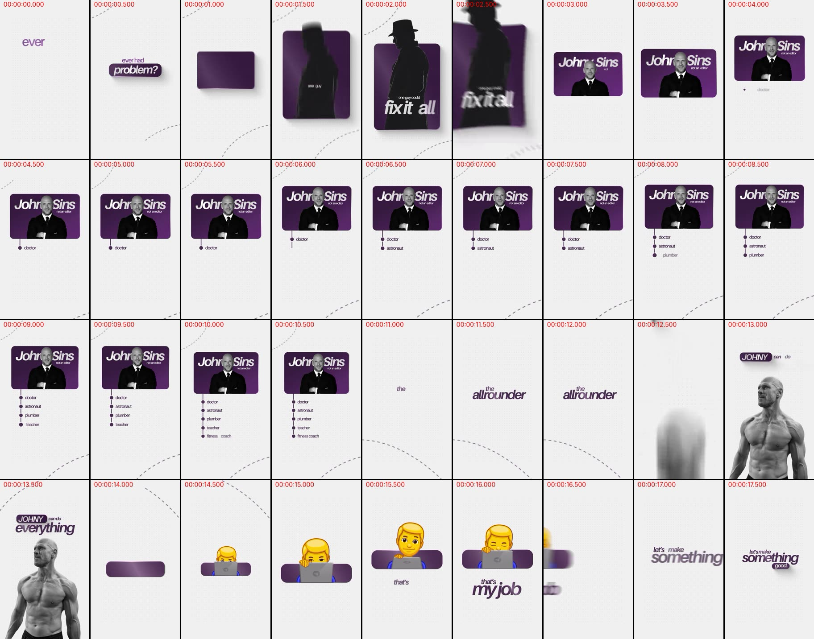

# Reference: danushkmotion — Let’s Edit ⚡️ #videoviral #editing #motiongraphics #motiongraphics #j.

- **Link:** https://www.tiktok.com/@danushkmotion/video/7613879612723957012?q=graphic%20motion&t=1794809448855
- **Tarikh simpan:** 2026-11-16 · **Durasi:** 18.3s · **Resolusi:** 720x1280
- **Statistik (masa simpan):** view_count 158,300 · like_count 8,606 · comment_count 122 · repost_count 2,953 · save_count 3,208
- **Caption asal:** Let’s Edit ⚡️ #videoviral #editing #motiongraphics #motiongraphics #johnysins 
- **Sir suka:** Suka gaya motion graphic

## Rentak
- Tukar visual (potongan keras) dikesan: **4 kali** → purata **3.7s** setiap visual
- Titik: 2.8, 10.8, 12.7, 13.9
- Contact sheet: 1 frame setiap 0.5s. Nota: animasi berterusan (motion graphic) jarang dikesan sebagai potongan — rujuk contact sheet.

## Transkrip
| Masa | Ayat |
|---|---|
| 0.0–3.0s | Ever had a problem and wished one guy could fix it all? |
| 3.0–4.4s | Meet Johnny Sins. |
| 4.4–6.5s | Doctor, he's got the stethoscope. |
| 6.5–8.5s | Astronaut, already in space. |
| 8.5–10.7s | Plumber, teacher, fitness coach? |
| 10.7–12.6s | Yep, somehow, also him. |
| 12.6–15.4s | Johnny can do everything, except edit your videos. |
| 15.4–18.3s | That's my job, so let's make something good. |

## Analisa (Claude)
**Jenis:** motion graphic penuh (tiada muka pencerita), voice-over, 18s. Repost tinggi (2.9k) → orang kongsi sebab gaya visual.
⚠️ Subjek video ni meme selebriti dewasa — **pinjam GAYA sahaja**, jangan guna orang/nama/konsep tu.

**Struktur (cerita mini 4 babak)**
1. **Hook soalan 0–2.5s:** "ever had problem?" → kad ungu dengan siluet "one guy could fix it all".
2. **Watak 3–10.7s:** kad profil (foto B&W potong atas kad, nama besar, label kecil "not an editor") + **senarai timeline** yang tumbuh satu-satu ikut VO (doctor → astronaut → plumber → teacher → fitness coach).
3. **Twist 10.7–15s:** "the allrounder" → "JOHNY can do everything" → potong: "…except edit your videos".
4. **Penyelesaian + CTA 15–18s:** emoji/ikon orang di laptop → "that's **my job**" → "let's make something good."

**Bahasa motion (ini yang Sir suka)**
- Latar putih pucat + grid titik halus + garis putus-putus melengkung yang bergerak perlahan → nampak "premium & tenang".
- **Satu warna aksen** (ungu gelap gradient) untuk kad & pil teks; teks hitam/ungu italik tebal.
- **Kinetic typography perkataan demi perkataan**: perkataan kecil ("ever had", "the", "that's") + perkataan kunci SANGAT besar ("problem?", "allrounder", "my job", "something").
- **Kad masuk dengan scale + motion blur**, keluar dengan whip/slide kabur → peralihan tanpa potongan keras (sebab tu pengesan potongan cuma jumpa 4).
- Foto B&W **pop-out** dari kad (kepala keluar dari bingkai) → kedalaman 3D ringkas.
- Elemen bertambah ikut VO (timeline bullet) → mata sentiasa ada benda baru setiap ±1s.
- Bayang lembut di bawah kad (drop shadow) → rasa "objek fizikal".

**Cara guna untuk Sir (cadangan)**
- ✅ Tukar ungu → **hijau #25D366** (kad/pil) + **kuning #FFD60A** untuk perkataan kunci; latar putih pucat + grid titik kekal.
- ✅ Kad profil → **kad "customer"** generik (ikon/siluet, bukan orang sebenar) dengan timeline objection: "mahal" → "nanti fikir" → "tanya suami" → *seen*.
- ✅ Kinetic type perkataan demi perkataan untuk **hook 3s pertama** video Sir, sebelum potong ke muka Sir.
- ✅ Struktur 4 babak (soalan → watak → twist → "itu kerja saya") → sangat padan untuk **versi Ads 15–20s**.
- ✅ Peralihan kabur (whip + motion blur) gantikan potongan keras antara kad.
- ⚠️ Teks kecil (label timeline) terlalu halus untuk phone — untuk Sir min. 42px pada 1080p.
- ⚠️ Semua teks kekal dalam safe zone (x 60–900, y 220–1440); reference ni letak teks hingga y ±1700.
