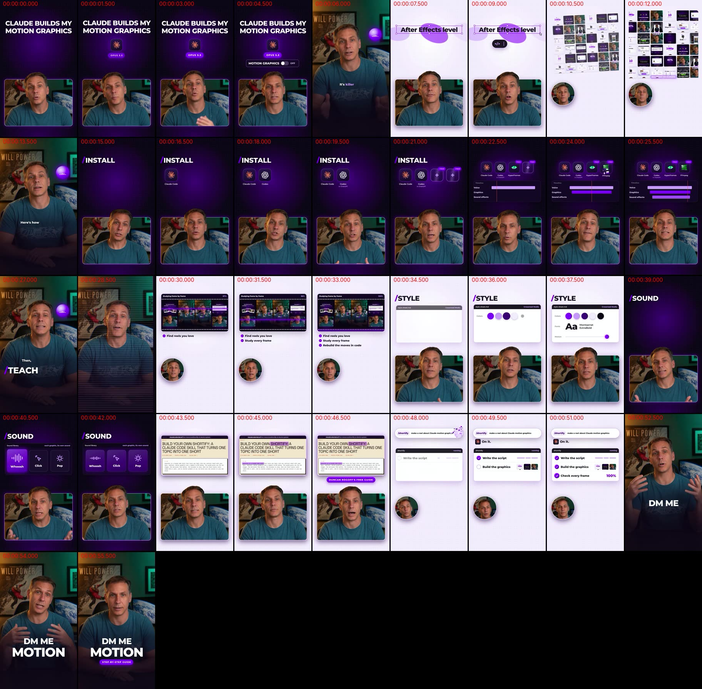

# Reference: calsaistudio — Turn Claude into your motion graphics editor 🔥 DM me "MOTION" and I'l.

- **Link:** https://www.tiktok.com/@calsaistudio/video/7692519013607312660
- **Tarikh simpan:** 2026-11-16 · **Durasi:** 56.5s · **Resolusi:** 720x1280
- **Statistik (masa simpan):** view_count 85,000 · like_count 3,603 · comment_count 754 · repost_count 787 · save_count 4,815
- **Caption asal:** Turn Claude into your motion graphics editor 🔥 DM me "MOTION" and I'll send you the step-by-step guide Every graphic in this reel was built in code by Claude. Two free tools do the heavy lifting, HyperFrames and FFmpeg, and Duncan Rogoff's Shortify system ties it together. Would you let Claude edit your reels? #claudecode #claudeai #motiongraphics #videoediting #creativeai
- **Sir suka:** Contoh cara Claude jadi editor motion graphic (HyperFrames + FFmpeg)

## Rentak
- Tukar visual (potongan keras) dikesan: **17 kali** → purata **3.1s** setiap visual
- Titik: 0.0, 6.0, 7.5, 8.8, 11.1, 12.7, 13.9, 15.4, 27.0, 29.3, 32.7, 34.6, 39.2, 43.7, 46.9, 47.9, 52.2
- Contact sheet: 1 frame setiap 1.5s. Nota: animasi berterusan (motion graphic) jarang dikesan sebagai potongan — rujuk contact sheet.

## Transkrip
| Masa | Ayat |
|---|---|
| 0.0–6.0s | Most people don't know you can turn Claude Opus 5.5 into a full motion graphics editor. |
| 6.0–12.5s | It's killer at it! I'd call it After Effects Level, all in code. Every graphic in this video |
| 12.5–18.8s | was built this way. Here's how I set it up. First, install Claude Code, or Codex if you use |
| 18.8–26.5s | ChatGPT, plus two free tools. Hyperframes turns code into video, and FFMpeg cuts and mixes |
| 27.4–33.7s | Then, teach your AI. Find reels you love and have it study them frame by frame and rebuild the moves |
| 33.7–38.6s | in code. Then, give it a style sheet with your colors, your fonts, and how things move. |
| 39.2–43.1s | Then, a sound effects library, so each graphic plays its own sound. |
| 43.7–49.1s | Last, set up the shortify system from Duncan Rogoff's free guide. One command writes the |
| 49.1–54.2s | script, builds the graphics, and checks every frame. DM me the word motion, |
| 54.2–58.2s | and I'll send you the step-by-step guide. |

## Analisa (Claude)
**Jenis:** tutorial "cara saya buat" (talking head + motion graphic), 56s. **Save (4.8k) > like (3.6k)** → kandungan jenis "simpan untuk guna nanti".

**Struktur**
1. **Hook 0–6s:** "Most people don't know…" + tajuk besar dua baris di atas, muka di bawah. Toggle "MOTION GRAPHICS OFF" → visual "hidupkan" sesuatu.
2. **Bukti 6–15s:** "After Effects level, all in code" + montaj grid semua grafik ("ALL BUILT BY CLAUDE").
3. **Peralihan 15s:** balik ke full-face "Here's how I set it up." → tanda bermula langkah.
4. **4 langkah bernombor** dengan header `/INSTALL` `/TEACH` `/STYLE` `/SOUND` (slash + huruf besar). Setiap langkah ada kad UI yang terbina sedikit demi sedikit ikut ayat (ikon muncul satu-satu, checklist ditanda, palet warna diisi).
5. **CTA 52–56s:** full-face + teks besar "DM ME / MOTION" → keyword DM (comment/DM funnel).

**Layout (3 mod, bertukar setiap ±3s)**
- A: grafik atas + muka dalam kad bucu bulat di bawah (mod utama)
- B: full-face, subtitle kecil tengah dengan 1 keyword berwarna
- C: grafik penuh skrin + muka dalam bulatan kecil di bawah kiri

**Gaya:** 1 warna brand (ungu) atas latar gelap/putih, Montserrat ExtraBold, kad UI bersih, cursor/kotak pilih (gaya "sedang diedit"). Setiap grafik ada bunyi sendiri (whoosh/click/pop).

**Apa nak pinjam untuk Sir**
- ✅ Header langkah `/NAMA` → padan dengan siri kita, contoh `/HOOK` `/ALASAN` `/AYAT` `/CLOSE`.
- ✅ Kad mockup terbina ikut ayat → untuk Sir: bubble chat WhatsApp generik muncul satu-satu, ayat closing ditaip.
- ✅ Tukar 3 mod layout setiap 2–4s → kekalkan mata tanpa B-roll stok.
- ✅ CTA keyword DM ("DM saya CLOSING") → sesuai sangat untuk niche WhatsApp closing (lead masuk WhatsApp/DM).
- ✅ SFX setiap grafik — kita dah ada konsep bunyi signature, boleh kembangkan jadi pustaka SFX.

**Tak sesuai / ubah**
- ❌ Warna ungu → guna hijau #25D366 + kuning #FFD60A (BRANDKIT).
- ⚠️ Teks CTA "DM ME MOTION" duduk ±y 1250–1400 (skala 1920) — rapat dengan had bawah safe zone kita (y ≤ 1440); kekalkan, jangan turunkan lagi.
- ⚠️ 56s panjang untuk organik Sir; versi Ads potong ke 15–25s (hook → 1 bukti → CTA).
